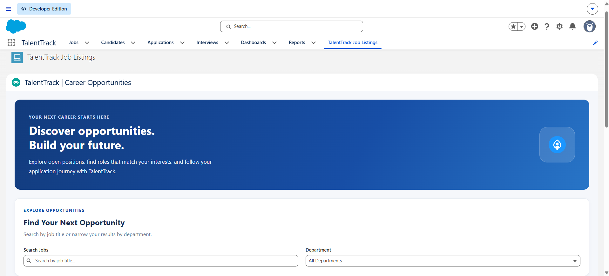
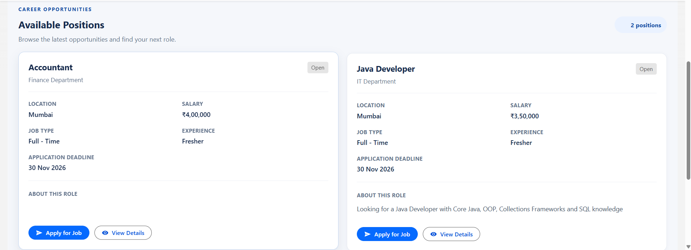
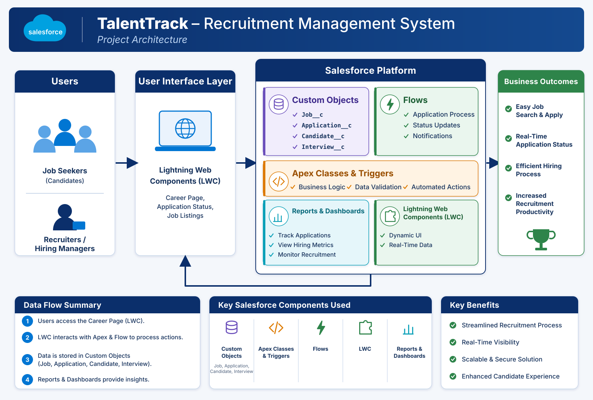

# TalentTrack – Recruitment Management System

A Salesforce-based Recruitment Management System designed to streamline job postings, candidate management, application tracking, and interview scheduling.

TalentTrack demonstrates practical Salesforce development using Apex, Lightning Web Components (LWC), SOQL, automation, and Salesforce security features.

## Project Overview

TalentTrack helps manage the recruitment lifecycle within Salesforce, from creating job openings to tracking candidates and managing interviews.

The application uses custom Salesforce objects, Apex triggers, Lightning Web Components, Flows, and reports to support recruitment operations.

## Application Screenshots

### 1. Career Page



### 2. Check Application Status


### 3. Full Job Listing View



---

## System Architecture

The following diagram illustrates the overall architecture of TalentTrack, including its Salesforce custom objects, Apex classes, triggers, Flows, Lightning Web Components, Reports, and Dashboards.



## Key Features

- **Job Management:** Create and manage job openings, including job details and deadlines.
- **Candidate Management:** Maintain candidate information and track candidate records.
- **Application Tracking:** Manage applications and monitor their recruitment status.
- **Interview Management:** Schedule and manage candidate interviews.
- **Job Listing Interface:** Display job listings through a custom Lightning Web Component.
- **Process Automation:** Use Apex triggers and Salesforce Flows to automate recruitment-related processes.
- **Scheduled Processing:** Use Apex Scheduler for automated job deadline processing.
- **Reports and Dashboard:** View recruitment data and monitor application statistics.
- **Data Security:** Apply Salesforce sharing rules and secure Apex data access.

## Technology Stack

| Technology | Purpose |
|---|---|
| Salesforce Platform | Application development |
| Apex | Business logic and server-side processing |
| SOQL | Salesforce data queries |
| Lightning Web Components | User interface |
| Salesforce Flows | Process automation |
| Apex Triggers | Record-based automation |
| Apex Scheduler | Scheduled processing |
| Salesforce Reports & Dashboards | Data analysis and visualization |
| Salesforce CLI | Deployment and development |
| Git & GitHub | Version control and source management |

## Salesforce Data Model

The project uses four main custom objects:

| Custom Object | Purpose |
|---|---|
| `Job__c` | Stores job opening information |
| `Candidate__c` | Stores candidate details |
| `Application__c` | Tracks candidate applications |
| `Interview__c` | Manages interview information |

These objects work together to represent the recruitment lifecycle.

### Salesforce Configuration – Job Object

**1. Job Object – Details**


**2. Job Object – Fields & Relationships**


## Project Structure

```text
force-app/
└── main/
    └── default/
        ├── applications/
        ├── classes/
        ├── flexipages/
        ├── flows/
        ├── layouts/
        ├── lwc/
        │   └── jobListing/
        ├── objects/
        ├── reports/
        ├── sharingRules/
        ├── tabs/
        └── triggers/
```

## Apex Development

The project uses Apex classes, triggers, and test classes to implement recruitment business logic.

Key development areas include:

- Trigger-based automation.
- Separation of trigger logic using handler classes.
- SOQL queries and DML operations.
- Scheduled Apex processing.
- Exception handling and business rule enforcement.
- Apex unit testing.

## Security Implementation

Security is an important part of the application.

- Apex controller uses `with sharing`.
- SOQL queries use `WITH USER_MODE`.
- DML operations use user-mode access.
- Salesforce sharing rules help manage record access.
- Sensitive authentication information is excluded from source control.

## Testing Results

All 29 Apex tests passed successfully.

| Test Metric | Result |
|---|---:|
| Tests Run | 29 |
| Passed | 29 |
| Failed | 0 |
| Pass Rate | 100% |

## Setup and Deployment

### Prerequisites

- Salesforce Developer Org
- Salesforce CLI
- Visual Studio Code
- Salesforce Extension Pack
- Git

### Steps

**1. Clone the repository**

```bash
git clone https://github.com/BhaveshShrivastav17/TalentTrack-Recruitment-Management-System.git
```

**2. Navigate to the project**

```bash
cd TalentTrack-Recruitment-Management-System
```

**3. Authorize your Salesforce org**

```bash
sf org login web
```

**4. Deploy the Salesforce source**

```bash
sf project deploy start --source-dir force-app/main/default
```

**5. Run Apex tests**

```bash
sf apex run test --test-level RunLocalTests --wait 10
```

*Note: Deployment and test execution require an authorized Salesforce org with the appropriate permissions.*

## Learning Outcomes

Through this project, I gained practical experience in:

- Salesforce Administration and Development.
- Apex programming and trigger frameworks.
- SOQL and Salesforce data modeling.
- Lightning Web Component development.
- Salesforce automation using Flows and Apex.
- Apex testing and debugging.
- Salesforce security and access control.
- Source control and deployment using Git and Salesforce CLI.

## Future Enhancements

- Candidate self-service application portal.
- Email notifications for interview scheduling.
- Advanced recruitment analytics.
- Enhanced candidate filtering and search.

## Author

**Bhavesh Shrivastav**

Aspiring Software Developer | Java & Salesforce

A postgraduate (M.Sc. IT) fresher interested in building software applications and developing skills in Java programming and Salesforce development.

Currently seeking entry-level opportunities as a **Java Developer** or **Salesforce Developer**.

[GitHub Profile](https://github.com/BhaveshShrivastav17)

---

*TalentTrack – Simplifying the recruitment management process with Salesforce.*
